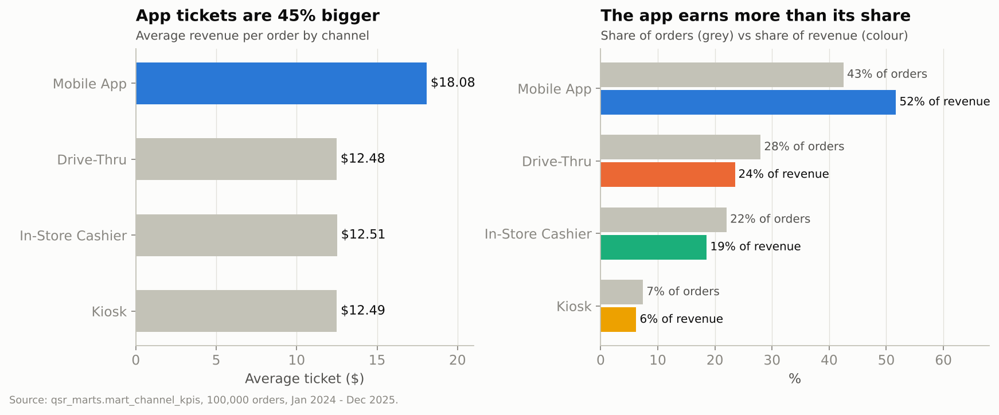
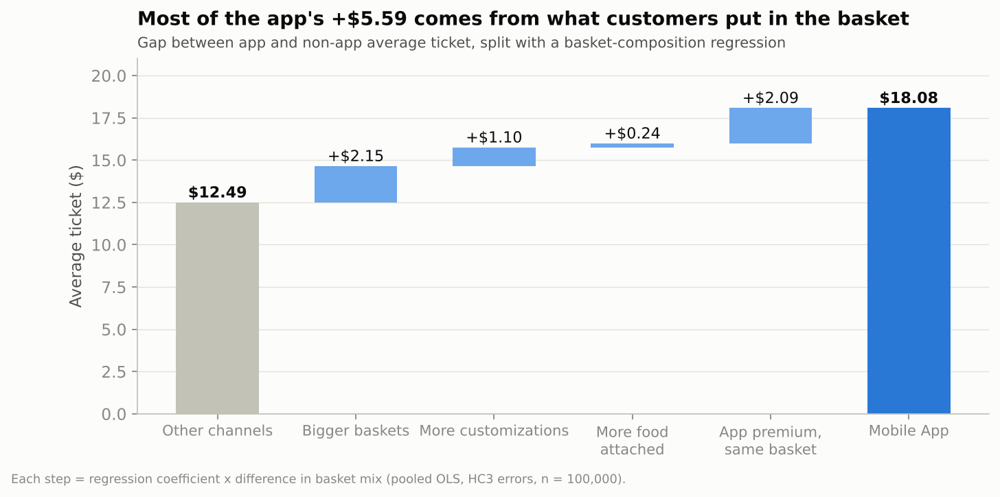
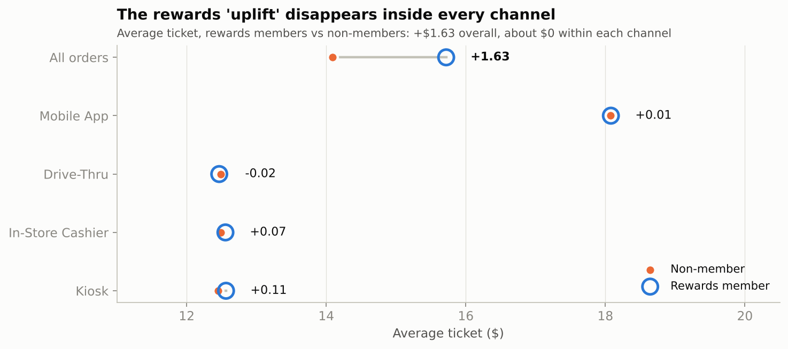
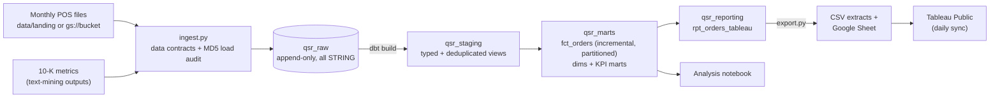

# QSR Revenue Growth Analytics

[](https://github.com/VicDeni/qsr-revenue-growth/actions/workflows/ci.yml)
[](https://github.com/VicDeni/qsr-revenue-growth/actions/workflows/pipeline.yml)

**Which lever moves revenue per order at a quick-service coffee chain: price, basket, channel or loyalty?**
An end-to-end project with three parts:
- **Pipeline:** a scheduled, Dockerized ELT pipeline that loads 100,000 orders and 30 years of Starbucks 10-K metrics into **BigQuery**, then models them with **dbt** (40 data tests).
- **Analysis:** pricing, demand and customer work on top of those tables.
- **Dashboard:** a **Tableau Public** dashboard fed by the same tables.

| | |
|---|---|
| 📊 **Dashboard** | [Tableau Public: QSR Revenue Growth Command Center](https://public.tableau.com/views/QSRRevenueGrowthCommandCenterv2/QSRRevenueGrowthCommandCenter) |
| 📓 **Analysis** | [`analysis/revenue_growth_analysis.ipynb`](analysis/revenue_growth_analysis.ipynb) |
| ⚙️ **Pipeline** | [`pipeline/`](pipeline) + [`dbt/`](dbt) → BigQuery, run daily by [GitHub Actions](.github/workflows/pipeline.yml) |

---

## Findings



1. **Channel is the biggest lever.** App orders average **$18.08**, against **$12.49** in every other channel (+45%). The app takes 42.5% of orders but 51.7% of revenue.
2. **62% of the app's +$5.59 is what goes in the basket:** +0.80 items, +1.19 customizations and more food. The remaining $2.09 is a same-basket app premium.
3. **The rewards "uplift" is a channel-mix illusion.** Member orders are $1.63 (11.6%) larger overall. Within each channel the gap is under ±$0.11, and the adjusted effect is +$0.02 (95% CI −$0.04 to +$0.09). Members simply use the app twice as often.
4. **Age gates app adoption, not spend.** The app takes 55% of orders from under-35s and 10% from customers 55+. Once channel is controlled, age has no effect on ticket.
5. **Customizations are a pricing surface.** Each one is worth ~$0.93, and together they make up 11% of revenue and appear on 81% of orders. Price elasticity can't be estimated from this data, so the notebook sizes a test instead: **~4,000 orders per arm** detects a 2% ticket change.
6. **Demand follows the clock, not the calendar.** Orders peak at 7am, noon and 4pm. Weekday and seasonal effects are not significant (χ² p = 0.63, 0.73).
7. **Satisfaction tracks the channel, not the wait.** Pooled data says each minute of wait costs 0.037 points; within a channel the effect is zero. Drive-thru sits 0.42 points below the app at every wait time.

<p float="left">
  
  
</p>

**Recommendations:**
- Grow app adoption among 35–54 customers, who place 40% of orders but only 35% of them on the app.
- Test customization pricing with a store-randomized design.
- Report loyalty impact within channel.
- Diagnose the drive-thru *experience*, not just its speed.

Sizing and caveats are in the [notebook](analysis/revenue_growth_analysis.ipynb).

**Strategy context from the 10-Ks (real data).** Starbucks went from 1,006 to 40,576 stores between FY1996 and FY2025; FY2025's +377 was the slowest growth since FY2012. "Mobile" first appears in Starbucks' 10-K in FY2013. McDonald's 10-K uses "franchise" 91 times per 10k words; Starbucks uses it zero times and talks about licensing and the app instead.

---

## Architecture



- **One Docker image, two targets.** Dev and CI run on **DuckDB**, so they need no cloud account. Production runs on **BigQuery**. The dbt models compile for both: the few dialect differences sit in [`dbt/macros/cross_db.sql`](dbt/macros/cross_db.sql).
- **Idempotent, incremental loads.** Every landing file is logged in `qsr_raw._load_audit` with its MD5, so a rerun loads nothing new. A corrected file sent again under the same name is reloaded, and staging keeps the latest copy of each order. `fct_orders` is an incremental `MERGE`, partitioned by month and clustered by channel and region.
- **Scheduled with GitHub Actions.** [`pipeline.yml`](.github/workflows/pipeline.yml) runs daily at 11:17 UTC. It authenticates to Google Cloud through **Workload Identity Federation**, so no service-account key is stored anywhere. It then builds the image, runs `ingest → dbt build → export`, and uploads the extracts as a workflow artifact.
- **Tested on every push.** [`ci.yml`](.github/workflows/ci.yml) runs ruff, 8 pytest unit tests (contracts, idempotency, redelivery) and the full pipeline end to end. It also checks that a second ingest loads nothing, then builds and runs the Docker image.

## Run it locally (no cloud account needed)

```bash
pip install -r requirements-dev.txt
make run        # ingest -> dbt build (15 models, 40 data tests) -> export Tableau extracts to exports/
make test       # lint + unit tests + end-to-end run
make analysis   # re-execute the notebook against the warehouse
make docker-run # same thing inside the Docker image
```

## Run it on BigQuery on a schedule

1. **Create the cloud resources.** In [Cloud Shell](https://shell.cloud.google.com), with this repo cloned, run:
   ```bash
   PROJECT_ID=<your-project> GITHUB_REPO=VicDeni/qsr-revenue-growth bash infra/setup_gcp.sh
   ```
   This creates the BigQuery datasets, a least-privilege service account and Workload Identity Federation. Add `LANDING_BUCKET=<bucket>` to also create a Cloud Storage landing zone. The whole project is ~20 MB, inside BigQuery's free tier.
2. **Connect GitHub.** Add the printed values as **repository variables**: `GCP_PROJECT`, `GCP_SERVICE_ACCOUNT` and `GCP_WORKLOAD_IDENTITY_PROVIDER`.
3. **Run it.** Go to **Actions → scheduled-bigquery-pipeline → Run workflow**. After that it runs daily.
4. **Optional: auto-refreshing dashboard.**
   - Create a Google Sheet and share it with the service account as Editor.
   - Set the `SHEETS_SPREADSHEET_ID` variable.
   - Point Tableau Public at that Sheet with *Keep my data in sync* ticked.

To run against BigQuery from your laptop instead, use `gcloud auth application-default login`, then `GCP_PROJECT=<id> make bq-run`.

## Data quality

`dbt build` runs **40 data tests** across 15 models:
- uniqueness and not-null on keys;
- accepted values and ranges for channel, hour, items, revenue and satisfaction;
- referential integrity from facts to dimensions;
- a reconciliation check that every order and every cent in staging reaches the reporting table.

**One warning is expected.** In 10 fiscal years the 10-K store breakdown doesn't sum to the reported total:
- FY2013–19: gaps of exactly 2,000–3,000 stores; the source notes record partial table parsing.
- FY1996–98: gaps of 2–28 stores, because licensed counts were estimated. Those years are flagged with `is_breakdown_complete`, and shares are computed on the parsed components, not silently on the total.

## Data and limitations

- **`data/landing/orders/`:** 100,000 Starbucks-style orders (Jan 2024 – Dec 2025), split into monthly files to mimic a POS feed.
  - The notebook's first section tests what this data can support. The data has no persistent customer behavior beyond age group, Poisson order frequency, no item prices or price changes, and no store effects, so it **appears simulated**.
  - The methods are the deliverable; the numbers illustrate them.
- **`data/landing/reference/`:** store counts and keyword metrics parsed from Starbucks 10-K filings (FY1996–FY2025), plus McDonald's and Dunkin' comparisons and US state population.
  - The population file runs ~2% below the Census Bureau's Vintage 2024 estimate for 2024 (333.3M vs 340.1M), so recent stores-per-million figures are slightly high.

## Repo layout

```
pipeline/      ingest (contracts, audit) · transform (dbt) · export (CSV / Google Sheets) · warehouse adapters
dbt/           sources, staging, marts, reporting, cross-dialect macros, generic + singular tests
analysis/      revenue_growth_analysis.ipynb, chart style, figures/
tableau/       make_twbx.py (generates the workbook + Hyper extract), BUILD_GUIDE.md, reference_layout.png
infra/         setup_gcp.sh (BigQuery, service account, Workload Identity Federation)
.github/       ci.yml (every push) · pipeline.yml (daily BigQuery run)
data/landing/  source files (orders by month + 10-K reference tables)
```
