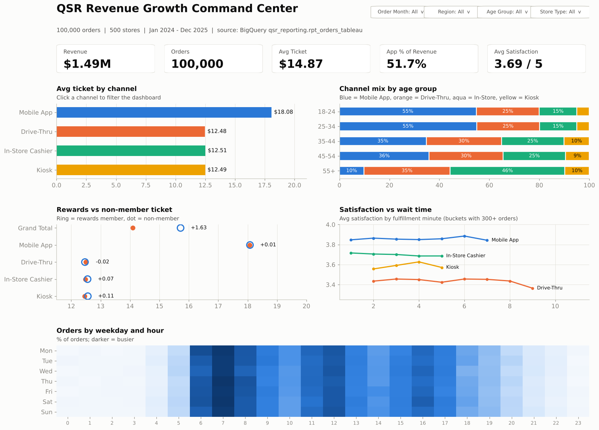

# Build the Tableau Public dashboard

**Target:** the layout in [`reference_layout.png`](reference_layout.png), published to your Tableau Public profile, with the link added to the repo README and your résumé.
**Time:** about 60–75 minutes for Dashboard 1, plus 20 minutes for the optional Dashboard 2.
**You need:** the free [Tableau Public](https://public.tableau.com/app/discover) desktop app and a Tableau Public account.

---

## 0. Choose the data source

| Option | When to use | How |
|---|---|---|
| **A. CSV (quickest)** | First build | Run `make run` (or `python -m pipeline run`), then connect to `exports/orders.csv`. |
| **B. Google Sheets (auto-refresh)** | After the scheduled BigQuery job is running | Set the `SHEETS_SPREADSHEET_ID` repo variable (see the README). Each run overwrites the `orders` tab, and Tableau Public re-syncs Google Sheets sources once a day. |

You can build on A and switch to B later with **Data → Replace Data Source**. Field names are identical in both.

## 1. Connect and check field types (5 min)

1. Open Tableau Public, then go to **Connect → To a File → Text file** and choose `exports/orders.csv`. For option B, use **Google Sheets** and pick the `orders` tab.
2. On the Data Source tab, check the type icons and fix any that are wrong:
   - `Order Date` and `Order Month` → **Date**
   - `Is App Order`, `Is Rewards Member`, `Has Food Item`, `Is Order Ahead` → **Boolean**. If the icon shows `Abc`, change it to Boolean.
   - `Revenue`, `Items`, `Customizations`, `Fulfillment Minutes`, `Satisfaction Score` → **Number**
3. Open a sheet. In the Data pane, drag `Order Hour`, `Weekday Number` and `Fulfillment Bucket (min)` up into **Dimensions**, then right-click each one → **Convert to Discrete**.
4. Right-click `Weekday` → **Default Properties → Sort** → *Sort by Field* `Weekday Number`, Minimum, Ascending.
5. Right-click `Order Channel` → **Default Properties → Color**, and assign these hex codes. They match the repo's figures and are colour-blind checked:

   | Channel | Hex |
   |---|---|
   | Mobile App | `#2a78d6` |
   | Drive-Thru | `#eb6834` |
   | In-Store Cashier | `#1baf7a` |
   | Kiosk | `#eda100` |

## 2. Calculated fields (10 min)

Create each one with **Analysis → Create Calculated Field**. Then set its number format under **Default Properties → Number Format**.

| Name | Formula | Format |
|---|---|---|
| `Orders` | `COUNT([Order ID])` | Number, 0 decimals, thousands separator |
| `Revenue $` | `SUM([Revenue])` | Currency, 0 decimals (display units: Millions, 2 decimals for the KPI) |
| `Avg Ticket` | `SUM([Revenue]) / COUNT([Order ID])` | Currency, 2 decimals |
| `App % of Revenue` | `SUM(IIF([Is App Order], [Revenue], 0)) / SUM([Revenue])` | Percentage, 1 decimal |
| `App % of Orders` | `SUM(IIF([Is App Order], 1, 0)) / COUNT([Order ID])` | Percentage, 1 decimal |
| `Avg Satisfaction` | `AVG([Satisfaction Score])` | Number, 2 decimals |
| `Items per Order` | `SUM([Items]) / COUNT([Order ID])` | Number, 2 decimals |
| `Customizations per Order` | `SUM([Customizations]) / COUNT([Order ID])` | Number, 2 decimals |
| `Food Attach Rate` | `SUM(IIF([Has Food Item], 1, 0)) / COUNT([Order ID])` | Percentage, 0 decimals |
| `Rewards Status` | `IIF([Is Rewards Member], "Rewards member", "Non-member")` | (dimension) |

Ratios are computed as SUM/COUNT, not AVG of a pre-computed average, so they stay correct under any filter.

## 3. Worksheets (35 min)

Name each sheet exactly as in **bold**, because the dashboard step refers to these names.

### **KPIs**
- Drag **Measure Names** to Columns and **Measure Values** to Text. Filter Measure Names to `Revenue $`, `Orders`, `Avg Ticket`, `App % of Revenue` and `Avg Satisfaction`.
- **Format → Font**: 22pt bold for values. Hide the row header and set the column headers to 10pt grey.

### **Ticket by Channel**
- Rows: `Order Channel`. Columns: `Avg Ticket`. Marks: **Bar**. Color: `Order Channel`. Label: `Avg Ticket`.
- Sort descending. Tooltip: add `Orders`, `Items per Order`, `Customizations per Order` and `Food Attach Rate`, so hovering shows *why* the app ticket is bigger.

### **Channel Mix by Age**
- Rows: `Age Group`. Columns: `Orders` → right-click → **Quick Table Calculation → Percent of Total**, then **Compute Using → Order Channel**.
- Color: `Order Channel`. Label: the same percent field, showing labels of 9% and above.
- Fix the axis at 0 to 1 and hide it, since the labels carry the values.

### **Rewards Check**
- Rows: `Order Channel`. Columns: `Avg Ticket`. Marks: **Circle**. Color: `Rewards Status` (non-member orange `#eb6834`, member blue `#2a78d6`). Size: small.
- Turn on **Analysis → Totals → Show Column Grand Totals**. The Grand Total row shows the overall gap of **+$1.63**, which sits next to the near-zero gaps inside each channel.
- Fix the axis at 11.5–20. Caption: *"The overall member gap is channel mix: within each channel it's under ±$0.11."*

### **Satisfaction vs Wait**
- Columns: `Fulfillment Bucket (min)` (discrete). Rows: `Avg Satisfaction`. Marks: **Line**. Color: `Order Channel`.
- Drag `Order ID` to **Filters → Count → At least 300**. This hides thin buckets.
- Fix the y-axis at 3.3–4.0. Label the line ends with the channel name (**Label → Line Ends**).

### **Demand Heatmap**
- Columns: `Order Hour` (discrete). Rows: `Weekday`. Marks: **Square**.
- Color: `Orders` → **Quick Table Calculation → Percent of Total** (Compute Using **Table**). Use the sequential **Blue** palette, with no stepped colours.
- Format: no borders, white row/column dividers, hide the field labels.

## 4. Dashboard 1: Command Center (15 min)

1. **New Dashboard.** **Size: Fixed, 1400 × 1100**. Tableau Public displays fixed sizes reliably.
2. Add a **Vertical** container. Inside it, place from top to bottom:
   - A **Text** object for the title, *QSR Revenue Growth Command Center*, with a subtitle line: *100,000 orders · 500 stores · Jan 2024–Dec 2025 · source: BigQuery `qsr_reporting.rpt_orders_tableau`*.
   - **KPIs** (height ~110 px).
   - A **Horizontal** container holding **Ticket by Channel** and **Channel Mix by Age**.
   - A **Horizontal** container holding **Rewards Check** and **Satisfaction vs Wait**.
   - **Demand Heatmap** (full width).
3. **Filters:** on any sheet, right-click `Order Month`, `Region`, `Age Group` and `Store Location Type` → **Show Filter**. Then click each filter's menu → **Apply to Worksheets → All Using This Data Source**. Place them in a horizontal row under the title. Use a *Range of Dates* control for `Order Month` and *Multiple Values (dropdown)* for the rest.
4. **Action:** **Dashboard → Actions → Add Action → Filter**. Source: **Ticket by Channel**. Run on: **Select**. Target: all other sheets. Clearing the selection shows all values. Clicking *Mobile App* now re-cuts every chart.
5. Hide every legend except one channel legend, since bars and lines are direct-labelled. Set **Format → Dashboard** background to `#fcfcfb`.

## 5. Dashboard 2 (optional): 30 years of strategy

Add three more data sources from `exports/`: `strategy_timeline.csv`, `keyword_trends.csv` and `competitor_language.csv`.

- **Store Footprint:** use `strategy_timeline`. Columns: `Fiscal Year` (continuous). Rows: `US Stores`, then drag `International Stores` onto the same axis to get Measure Names/Values. Marks: **Area**, stacked. Colours: US `#2a78d6`, International `#9ec5f4`. Add `Total Stores` to the tooltip, and add an annotation on FY2025: *+377 stores, slowest growth since FY2012*.
- **10-K Language:** use `keyword_trends`. Filter `Keyword` to mobile, digital, app and rewards. Columns: `Fiscal Year`. Rows: `Mentions per 10k Words` → **Quick Table Calculation → Moving Average** (previous 2 values, current value). Color: `Keyword`.
- **Starbucks vs McDonald's:** use `competitor_language`. Filter `Fiscal Year` = 2025 and `Keyword` to franchise, licensed, drive, digital, mobile, app, loyalty and delivery. Rows: `Keyword`, then `Company`. Columns: `Mentions per 10k Words`. Color: `Company`.

Lay these out on a second dashboard titled **30 Years of Starbucks Strategy (10-K)**.

## 6. Publish and link (5 min)

1. **File → Save to Tableau Public As…** and name it *QSR Revenue Growth Command Center*.
   - If you used Google Sheets, tick **Keep my data in sync with the data source and embed my credentials**. This turns on the daily refresh.
2. On the viz page, open **Edit Details**:
   - Add a description, for example: *Built on a BigQuery + dbt pipeline scheduled with GitHub Actions; analysis notebook and code:*
   - Add your GitHub repo URL.
   - Turn on **Show sheets as tabs** if you built Dashboard 2.
3. Copy the viz URL and put it in three places:
   - `README.md`: replace `TABLEAU_PUBLIC_URL`.
   - Your résumé project line.
   - The **Featured** section of your LinkedIn profile.

## Interview notes (why it's built this way)

- **The dashboard reads one curated reporting table**, `rpt_orders_tableau`, built and tested by dbt. All business logic lives upstream in SQL, and Tableau does presentation only.
- **Ratios are SUM/COUNT calcs**, so filters and drill-downs never average an average.
- **The Rewards Check view is deliberately skeptical.** It shows the naive member uplift and the within-channel truth on one sheet.
- **Tableau Public can't connect to BigQuery.** The pipeline therefore publishes extracts, either CSV or a Google Sheet that Tableau Public re-syncs daily.
